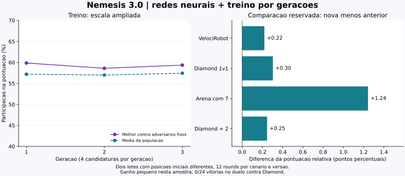

# Nêmesis 3.0 — experimento de evolução

Experimento realizado em 7 de novembro de 2026. A versão entregue combina redes neurais que aprendem durante os rounds, simulações físicas e treino externo por gerações. Todo o robô, incluindo os pesos pré-treinados, continua em `robots/equipe/Nemesis.java`.

**Resultado:** o fluxo de treino funciona e a pontuação relativa média melhorou pouco nesta amostra. O robô continua vencendo adversários básicos, mas não alcançou o nível do Diamond. Esta é uma evolução experimental, não uma garantia de superioridade.

## O que foi executado

Foram **488 rounds novos** nesta etapa:

| Etapa | Rounds |
| --- | ---: |
| Exploração da versão anterior em cinco cenários novos | 60 |
| Três gerações de quatro candidaturas, adversários fixos e arena entre variantes | 204 |
| Pré-treino sequencial dos modelos da candidata escolhida | 32 |
| Comparação reservada: duas versões × quatro cenários × dois lotes × 12 rounds | 192 |
| Total | 488 |

O treino colocou cada candidata em arenas com vários inimigos, chegando a sete robôs no total. Em cada geração, as quatro candidatas também se enfrentaram. Houve seleção, preservação da melhor candidata, cruzamento e mutação. Alguns indivíduos repetem os genes de um elite; não são doze estratégias completamente distintas.

O ambiente foi Robocode clássico 1.12.0, Java 21.0.13, compilador Eclipse 3.37.0 com alvo Java 8, arena 800 × 600, resfriamento 0,1 e CPU calibrada em 5.344.295 ns. O Diamond foi compilado do código público no commit `2d1c6a2b911cf077c5f13d2baa45da7d18d6babb`, sem alterar sua estratégia.

## Evolução medida no treino

| Geração | Vencedora da geração | Fitness de seleção | Média contra adversários fixos da vencedora |
| --- | --- | ---: | ---: |
| 1 | G0C0 | 0,5162 | 57,63% |
| 2 | G1C2 | 0,5194 | 58,60% |
| 3 | G2C3 | 0,5517 | 59,36% |

A fitness mistura pontuação contra adversários fixos, arena entre candidatas e penalidade de CPU. A composição da arena de candidatas muda entre gerações. O gráfico mostra também a melhor participação apenas contra os adversários fixos; essa medida não cresceu continuamente. Não se deve confundir a curva de seleção com habilidade garantida fora do treino.

O algoritmo escolheu G2C3 sem usar as comparações reservadas. Depois houve pré-treino em quatro cenários de treino, transferindo os pesos gerais entre as batalhas. O modelo final incorporado tem **1.228 observações de mira e 128 de defesa**. A defesa usa impactos e colisões entre balas; não observamos todas as balas inimigas.

## Comparação reservada contra a versão 2.0

Cada cenário teve dois lotes com posições iniciais diferentes, **12 rounds por lote e versão**. A tabela mostra a média da participação na pontuação total de cada batalha, e não a porcentagem de acertos nem a taxa de vitória. As regras e posições de cada lote foram iguais para a versão antiga e a candidata.

| Cenário | Versão anterior | Nêmesis 3.0 | Diferença | Vitórias da nova versão |
| --- | ---: | ---: | ---: | ---: |
| VelociRobot — duelo | 99.01% | 99.23% | +0.22 pp | 24/24 |
| Diamond — duelo | 9.27% | 9.57% | +0.30 pp | 0/24 |
| Arena com sete robôs | 33.40% | 34.64% | +1.24 pp | 24/24 |
| Diamond + SpinBot + TrackFire | 29.69% | 29.93% | +0.25 pp | 0/24 |

A média simples dos quatro cenários passou de **42.84% para 43.35%**, um ganho de **0.50 ponto percentual**. É um ganho pequeno. Não há intervalo de confiança nem avaliação estatística suficiente para afirmar uma melhora geral.

Nos dois lotes, tanto a versão antiga quanto a nova venceram todos os rounds contra VelociRobot e na arena com sete robôs. No duelo com Diamond, ambas ficaram em **0/24**. No grupo que inclui Diamond, ambas também ficaram em **0/24 primeiras colocações**.

Na arena com sete robôs, a candidata piorou no primeiro lote (34,16% para 32,57%) e melhorou no segundo (32,64% para 36,71%). No duelo Diamond, o ganho do primeiro lote também não se repetiu no segundo. Esses casos mostram por que uma única posição inicial seria uma evidência fraca.

A precisão agregada contra Diamond passou de **73 acertos em 1.483 tiros (4,92%)** para **84 em 1.458 (5,76%)**. Ainda é muito baixa. No grupo com Diamond, passou de 15,33% para 17,52%; na arena com sete robôs caiu de 57,42% para 53,24%. A pontuação depende também de potência, dano e sobrevivência, não apenas de acertos.

Os contadores da comparação registraram sete turnos perdidos na versão anterior e um na nova, todos em duelos contra Diamond; zero colisões com paredes nas comparações registradas. Esses números dependem de aquecimento da JVM, carga da máquina e padrões da batalha. Não demonstram que a rede seja sempre mais rápida ou que paredes nunca serão atingidas.

## O que os testes comprovam — e o que não comprovam

- O arquivo final compila com a API real; os pesos incorporados carregam e as probabilidades permanecem normalizadas.
- Testes numéricos verificam aprendizagem condicional por retropropagação, mudança dos pesos ocultos, replay, exportação/restauração e rejeição de modelo inválido.
- O treinador preserva os pesos quando renomeia uma candidata para compará-la, verifica quantidade de participantes e conclusão de cada batalha.
- A melhoria medida pertence ao conjunto: genes, estatísticas, planejamento e redes. **Não houve teste de ablação para isolar o efeito da rede neural.**
- Os cenários de comparação não foram usados para selecionar os genes, mas alguns robôs aparecem em outras composições no treino. VelociRobot não participou dos cenários de treino. Isso não equivale a testar contra uma coleção inteira de adversários desconhecidos.
- Os rounds de um lote repetem a posição inicial; os robôs podem aprender entre eles. Não são 24 partidas independentes por cenário. A aleatoriedade interna dos adversários e a carga da JVM não foram totalmente fixadas.
- As arenas com vários adversários são todos contra todos, não equipes coordenadas de dois ou três contra um.

## Análise das próximas melhorias

1. **Mira contra robôs adaptativos:** a precisão contra Diamond continua abaixo de 6%. Vale medir tempo desde inversões de direção, histórico de deslocamentos e vizinhos de situações semelhantes, comparando essas alternativas com a mira neural atual.
2. **Qualidade das ondas:** em melee, energia perdida para terceiros pode parecer um disparo. Melhorar a confiança do instante e da origem das ondas deve preceder aumentar muito o modelo de defesa.
3. **Mais dados de defesa:** 128 exemplos são poucos para uma rede com muitas conexões. Mais diversidade, regularização e comparação com a defesa somente estatística devem orientar o próximo ciclo.
4. **Separar o efeito de cada componente:** comparar rede ligada/desligada com os mesmos genes e condições, em vários lotes, antes de atribuir o ganho à IA.
5. **Treino mais variado:** ampliar as posições, tamanhos de arena e adversários competitivos; avaliar também equipes reais. Só aumentar gerações contra os mesmos robôs pode especializar demais o comportamento.

## Arquivos e reprodução

- [TREINAMENTO.md](TREINAMENTO.md): funcionamento das redes, evolução e comandos.
- [tests/evolution-results.json](tests/evolution-results.json): genes, rankings, pesos de avaliação e primeiro lote reservado.
- [tests/validation-second.json](tests/validation-second.json): segundo lote e contadores dos robôs.
- [tests/training-scenarios.json](tests/training-scenarios.json): participantes, rounds e posições iniciais.
- [tests/exploratory-results.json](tests/exploratory-results.json): os 60 rounds exploratórios.
- [tests/core_checks.py](tests/core_checks.py) e [tests/trainer_checks.py](tests/trainer_checks.py): verificações automatizadas.

Os JSONs registram o SHA-256 do arquivo final e da versão anterior. As variantes e classes auxiliares ficam apenas na instalação separada de testes. O único arquivo fonte Java do robô no repositório é `Nemesis.java`.
