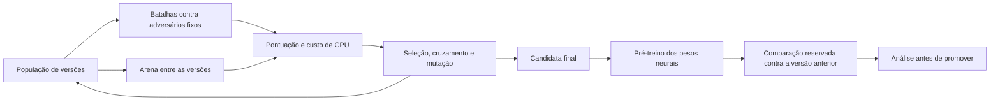

# Treino por gerações e redes neurais

O pedido é combinar duas formas de aprendizado: uma rede neural que se adapta dentro dos rounds e versões do robô que competem por gerações. A referência enviada foi [Rede Neural aprendendo a jogar o jogo da cobrinha (SNAKE)](https://youtu.be/awz1ghokP3k), junto da playlist [Redes Neurais Artificiais em Python](https://www.youtube.com/playlist?list=PL-t7zzWJWPtygNTsgC_M8c9a-p5biCjho). Foi possível identificar os títulos e o tema; a transcrição completa do primeiro vídeo não ficou acessível. Não se afirma reproduzir o algoritmo exato desses vídeos.

## Dentro do round

O Nêmesis simula opções de tiro e movimento sem precisar executar todas elas na arena. Uma simulação é uma hipótese baseada no que o radar observou. Não usa posições ocultas nem controla a ação futura dos inimigos.

- Avalia destinos e frenagem, simula até 100 ticks de movimento e estima onde cada rota cruza as quatro ondas mais próximas.
- Compara cinco miras virtuais: direta, linear, circular, GuessFactor e neural. A pontuação recente de cada mira define qual usar.
- Uma rede para mira e outra para defesa usam 12 entradas, 16 neurônios ocultos com `tanh` e 47 probabilidades de saída com `softmax`.
- As entradas incluem distância, velocidade lateral e de aproximação, aceleração, curva, espaço nas paredes, tempo de voo da bala, velocidade e quantidade de inimigos.
- Quando uma onda de tiro alcança um adversário observado, sua posição fornece um exemplo para a mira. Impactos e colisões entre balas fornecem exemplos para a defesa.
- Os pesos mudam por retropropagação/descida de gradiente. Uma memória limitada revisa uma experiência antiga para cada nova observação. Não há replay ilimitado nem treino pesado a cada tick.
- Modelos por adversário se misturam com um modelo geral; inimigos novos aproveitam o conhecimento geral. As estatísticas tradicionais continuam como alternativa e a rede neural precisa disputar com as outras miras.

A rede prevê distribuições de ângulos, não ordens diretas para acelerar ou virar. O planejamento físico continua escolhendo a rota. Isso mantém uma base funcional enquanto a rede aprende. Os exemplos de defesa são enviesados para os tiros que conseguimos observar; não constituem um mapa perfeito de todas as balas disparadas.

## Fora do round



O script [tools/train.py](tools/train.py) cria variantes temporárias numa instalação de testes do Robocode. Elas enfrentam vários inimigos de uma vez e também lutam entre si. O treino usa o motor real, não uma aproximação Python da batalha.

Cada indivíduo tem dez genes: peso da esquiva, distância de duelo, taxa de aprendizado neural, mistura neural da defesa, repulsão de inimigos, potência de tiro e quatro parâmetros que definem fases/escalas dos pesos neurais iniciais. A busca genética altera essa parametrização compacta dos pesos; não muta cada uma das milhares de conexões de forma independente, nem altera a topologia como no NEAT.

Há elitismo, cruzamento dos dois melhores e mutação com limites. No formato atual, o treinador prioriza séries vencidas em três rounds: 70% para vencer a série, 20% para vitórias de rounds e 10% para pontuação relativa. Esses valores são combinados contra adversários fixos (80%) e na arena entre variantes (20%), com penalidade para turnos perdidos. O objetivo antigo, somente de pontuação, permanece disponível com `--objective score` para reproduzir experimentos históricos. A parcela da arena depende dos concorrentes da geração, portanto a fitness total não deve ser interpretada como uma curva absoluta de habilidade.

Depois da seleção, há um pré-treino sequencial com os cenários de treino. Os pesos gerais são transferidos entre essas batalhas, enquanto o aprendizado por adversário continua ocorrendo dentro de cada batalha. A candidata resultante tem esses pesos incorporados como constantes no próprio `Nemesis.java`, dispensando arquivos de modelo na instalação do jogador.

Os cenários reservados só são executados depois da seleção e do pré-treino. Alguns adversários já aparecem no treino em outras composições; isso mede novas condições, não generalização para uma coleção inteiramente desconhecida de robôs. A ferramenta **não publica no GitHub nem promove automaticamente** a candidata.

## Como repetir

Use uma cópia separada da instalação do Robocode: o treino instala classes temporárias no pacote `treino`. Instale o [Diamond](https://github.com/Voidious/Diamond) nessa cópia. Python 3 usa somente a biblioteca padrão; o motor e a compilação exigem Java e a API do Robocode.

Prepare uma cópia da versão anterior usando o Git:

```sh
git show e46aecbe34f8a7171a6985d0261782766b79ec0d:robots/equipe/Nemesis.java > /tmp/Nemesis-v2.java
```

Execute com um JDK que tenha `javac`:

```sh
python tools/train.py --home /caminho/robocode-testes --baseline /tmp/Nemesis-v2.java --population 4 --generations 3 --rounds 3 --validation-rounds 3
```

Ou acrescente `--ecj /caminho/ecj.jar` para usar o compilador Eclipse. `--seed` define as mutações, e `--position-seed` varia as posições iniciais planejadas pelo treinador; essas opções não fixam todos os geradores aleatórios internos de cada adversário. As posições de um cenário se repetem entre seus rounds para permitir comparações com o mesmo início. Variar sementes e repetir lotes reduz o risco de especialização.

Por padrão, novos ciclos começam com os genes do arquivo atual, mas zeram os modelos durante a seleção genética e refazem o pré-treino depois. Para começar com os genes originais do experimento registrado, acrescente `--initial-genome '[1,430,0.025,0.4,18000,1,0,1,0,1]'`.

Para comparar o arquivo atual com a versão anterior em outras posições, sem refazer o treino:

```sh
python tools/evaluate.py --home /caminho/robocode-testes --baseline /tmp/Nemesis-v2.java --rounds 3 --position-seed 1000
```

O relatório medido deste ciclo está em [EVOLUCAO.md](EVOLUCAO.md). Para regenerar o gráfico a partir dos JSONs registrados, use `python tools/plot_training.py`; somente essa ferramenta opcional requer `matplotlib`.

Os resultados ficam em `training-runs/latest`: rankings, composição das arenas, posições iniciais, logs, comparação reservada e um `Nemesis.java` proposto. Não copie a candidata sem revisar sua pontuação, comportamento e custo de CPU. Os arquivos temporários `.java` do treinador não fazem parte do código fonte entregue do robô.

## Persistência

Os pesos pré-treinados incorporados ao arquivo são a base de cada nova batalha. Durante a batalha, redes e histogramas aprendem e são preservados entre os rounds. O progresso novo do jogador não é salvo automaticamente ao encerrar a batalha. Para atualizar a base incorporada, é necessário um novo ciclo externo de treino e validação.

Mais gerações não garantem evolução: uma população pode ficar especializada, modelos podem piorar e a aleatoriedade pode produzir uma vitória enganosa. O relatório do experimento registra o que foi medido, inclusive regressões.

## Formato oficial: três rounds

A competição foi confirmada como **quem vence dois dos três rounds**. Por padrão, treino e validação genética agora usam exatamente três rounds e objetivo `series`. O pré-treino também usa séries curtas nesse modo. Os arquivos `.battle` foram ajustados para três rounds. Os relatórios antigos de 12 ou 30 rounds são históricos e não provam desempenho em melhor de três.

Para a comparação específica de partidas curtas e início com memória nova, veja [MELHOR-DE-TRES.md](MELHOR-DE-TRES.md) e use `tools/bo3.py`. Ele compara as alternativas de adaptação rápida contra um adversário com a versão anterior, Diamond e grupos de inimigos; seleciona em posições de treino e mede depois em outras posições.
