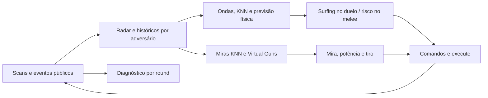

# Arquitetura real — Titan Prime 4.15

A arquitetura 3.x foi substituída por uma adaptação licenciada do Diamond aberto, fixada no commit `2d1c6a2b911cf077c5f13d2baa45da7d18d6babb`. Todo o motor de produção e seus tipos auxiliares estão dentro de `equipe.titanprime`, no único [fonte Java](robots/equipe/titanprime.java). A [licença](licenses/diamond.txt) e o [manifesto de origem](tests/elite/import-manifest.json) identificam o que foi incorporado.

## Combate

O radar atualiza os dados observáveis. Os gerenciadores de mira e defesa mantêm históricos distintos e compartilham a informação de cada tiro próprio para calcular sombras nas ondas inimigas. O controle central chama movimento, mira, radar e `execute`, sem manter os antigos controladores 3.x em paralelo.

No duelo, duas ondas ordenadas pelo tempo estimado de impacto orientam as simulações defensivas. O preditor considera aceleração, frenagem, inversão, velocidade, rotação e geometria. A avaliação usa interseções da onda com estados previstos do corpo e ângulos de escape calculados com paredes. Isso melhora a base geométrica; não revela o rumo secreto de uma bala.

As miras competem por resultados virtuais de ondas. Duas redes neurais de 13 entradas, 20 unidades ocultas e 61 saídas GuessFactor também participam, com velocidades de aprendizado distintas. Elas começam com pesos incorporados do treinamento externo e continuam aprendendo com ondas reais e amostras virtuais selecionadas. A mira inicial fornece uma resposta antes de acumular exemplos próprios. Os modelos principal e anti-surfer aprendem com contextos de movimento e janelas históricas. O ganho do pacote não foi isolado por componente; os testes não provam qual classe explica cada vitória.

No melee, 64 direções geram posições avaliadas por proximidade, energia, geometria dos adversários e posições recentes. A adaptação limita a busca de alternativas ao número de candidatos; se nenhuma rota for segura, freia por um tick e replaneja. Divisões por distância ou energia zero são protegidas. Quando sobra um adversário, o motor passa para duelo.

## Memória e observação

Os componentes persistem entre rounds e reinicializam o estado transitório de cada um. O aprendizado estatístico atravessa os rounds da mesma batalha. Uma batalha independente recarrega modelos neurais, avaliações de miras e amostras defensivas de suas cópias locais válidas. Quando faltam dados compatíveis, começa com o modelo inicial incorporado. Não importa arquivos privados do adversário. Veja [aprendizado entre batalhas](aprendizado.md).

Os contadores adicionados observam tiros reais retornados pela API, eventos de acerto, colisões, ticks e resultados. Eles não escolhem ações. O CSV `diagnostico.csv` usa o esquema 4.0 e conserva até 48 KB de registros recentes. Um CSV de esquema 3.x é substituído na migração; guarde uma cópia antes de atualizar caso queira conservar o histórico.

`duel_shots_resolved` e `duel_hits_resolved` contam ondas inimigas já resolvidas pelo modelo de duelo, excluindo intercepções entre balas; não são todos os tiros efetivamente disparados. Dano nominal não é a perda efetiva de energia de um alvo quase morto.

`onWin` informa a vitória de um round. A comemoração começa após esse evento. Impactos terminais do mesmo tick são preservados mesmo depois da primeira notificação de morte, e eventos posteriores são excluídos do diagnóstico congelado. O gravador substitui a linha do mesmo round quando a notificação de vitória é posterior a `onRoundEnded`, sem duplicá-la.

## Validação

As séries reservadas usam a classe canônica para todas as versões, o JAR original do Diamond, regras iguais, memória inicial limpa e posições verificadas em snapshots. Primeiras colocações simultâneas são descontadas de forma conservadora. Os [testes atuais](tests/readme.md) verificam previsões contra trajetórias registradas no motor, KNN contra busca exaustiva, recuperação de paredes e persistência real.

O [relatório do ciclo](ciclo-elite.md) apresenta os resultados, tentativas e limites. Os demais relatórios 3.x permanecem históricos.
