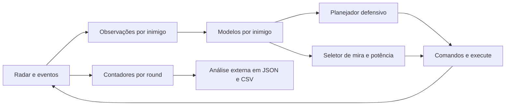

# Arquitetura real do Titan Prime

A descrição de robô autônomo fornecida pelo usuário serve como direção técnica. A implementação atual, **3.6**, mantém um arquivo `robots/equipe/titanprime.java` e organiza responsabilidades em métodos e classes internas. Ela não implementa todos os recursos possíveis citados na descrição.

## Radar e modelo de inimigo

O radar tem rotação independente, lock com overshoot no duelo e varredura para múltiplos adversários ou perda de alvo. Observações guardam timestamp, posição, rumo, velocidade e energia. Previsões entre scans são estimativas limitadas, não acesso à posição oculta do adversário.

## Defesa

Wave Surfing avalia trajetórias físicas, ondas estimadas e perigo aprendido. O risco espacial considera inimigos, distância, paredes e continuidade do destino. O modelo usa histogramas e redes neurais; **o KNN defensivo experimental não foi adotado**. A presença de KNN na mira não significa que a defesa ganhou o mesmo sistema.

O movimento próprio respeita giro dependente de velocidade, aceleração, frenagem e inversão. A avaliação de cruzamento de ondas ainda tem aproximações geométricas. As verificações do simulador próprio não demonstram previsão perfeita das decisões inimigas.

## Ataque

Até sete alternativas competem: direta, linear, circular, GuessFactor, neural, KNN de visitas e KNN associado a disparos reais. Ondas sem bala ampliam a observação de movimento; apenas ondas de tiros reais avaliam as miras virtuais. Potência, reserva, alinhamento e frescor do alvo restringem o disparo.

O sistema reúne três formas de aprendizado: histogramas, KNN e redes neurais com retropropagação. Assim, embora a arquitetura conceitual possa funcionar sem rede neural, **o Titan atual usa redes neurais**, além dos outros modelos.

## Controle e memória

Um ciclo central escolhe alvo, radar, movimento e tiro e chama `execute`. Cada evento atualiza os modelos e o estado correspondente. A memória por adversário atravessa os rounds da batalha. O novo aprendizado do jogador não é salvo automaticamente entre batalhas independentes; modelos pré-treinados estão incorporados ao Java.

`onWin` sinaliza vitória de **um round**, iniciando a comemoração. Vencer a série exige pelo menos duas primeiras colocações nos três rounds. A ordenação padrão por pontos do jogo não substitui essa regra.

## Observabilidade e validação

Na 3.6, a telemetria observa eventos e decisões sem escolher ações. Ela mede dano nominal, custo dos tiros, scans, faixas de distância e associações de impactos com ondas, com limites e campos ausentes explícitos. A ferramenta externa produz CSV e compara séries; veja [telemetria.md](telemetria.md).

A avaliação começa com memória controlada, registra posições efetivas, usa batalhas independentes de três rounds e mantém resultados desfavoráveis. Mais módulos ou mais técnicas citadas não são evidência de ganho de combate.

O [plano de evolução](plano-de-evolucao.md) distingue recursos presentes, parciais e futuros. O [estudo ofensivo](ataque-experimentos.md), as [referências de ataque](referencias-ataque.md) e as [referências de defesa](referencias-defesa.md) registram o que foi estudado e efetivamente adotado.
